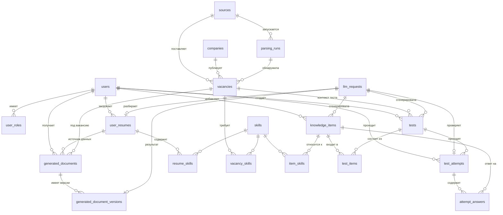

# Jobly — модель данных

Описание сущностей базы данных Jobly и того, как они взаимодействуют друг с
другом. Это не справочник по полям «ради полей»: главная цель документа —
показать, какие данные откуда берутся и куда уходят в основных сценариях
сервиса.

> Статус: **черновик схемы**. Типы и названия колонок согласуются при
> проектировании миграций; связи и смысл сущностей — основа, от которой
> отталкиваемся.

---

## 0. Что такое Jobly

Jobly — сервис для поиска работы и стажировок.

- **Парсинг вакансий** — собираем вакансии и стажировки напрямую с сайтов
  компаний и с агрегаторов вроде hh.
- **Резюме под вакансию** — из загруженного резюме пользователя формируется
  отдельное резюме, заточенное под конкретную вакансию.
- **Сопроводительное письмо** — генерируется для той же вакансии.
- **Локальная YandexGPT 5 Lite через Ollama** — генерация идёт через локальный
  HTTP-сервер, данные
  пользователя не уходят во внешние API.
- **База знаний** — типовые вопросы и задачи от работодателей.
- **Тесты на уровень знаний** — собираются из базы знаний.

Вопросы, задачи и тесты можно дополнять вручную или поручить это нейросети.

Остальной документ отвечает на вопрос: в каких таблицах всё это живёт и как
связано.

---

## 1. Обзор: пять групп сущностей

| Группа | Сущности | За что отвечает |
|---|---|---|
| Пользователи | `users`, `user_roles`, `user_resumes`, `resume_skills` | аккаунт, роли и исходное резюме, из которого берутся данные для генерации |
| Вакансии | `sources`, `companies`, `vacancies`, `vacancy_skills`, `parsing_runs` | то, что спарсили, и откуда это взялось |
| Навыки | `skills` | общий справочник — связывает вакансии, резюме и базу знаний |
| Генерация | `llm_requests`, `generated_documents`, `generated_document_versions` | обращения к YandexGPT 5 Lite и версии резюме и писем |
| Знания и тесты | `knowledge_items`, `item_skills`, `tests`, `test_items`, `test_attempts`, `attempt_answers` | вопросы, задачи, тесты и результаты прохождения |

`skills` — центральная точка схемы. Через неё вакансия «знает», какие вопросы
из базы знаний ей релевантны, а пользователь — какие пробелы в навыках у него
есть относительно вакансии.

---

## 2. ER-диаграмма

---

## 3. Сущности

### 3.1 Пользователи

**`users`** — аккаунт.

| Поле | Смысл |
|---|---|
| `id` | первичный ключ |
| `email` | логин, уникален |
| `password_hash` | хеш пароля |
| `full_name` | имя для подстановки в резюме и письма |
| `created_at` | дата регистрации |

**`user_roles`** — роли пользователя для разграничения доступа. Первичный ключ
составной: (`user_id`, `role`). По этим записям API формирует массив `roles`.

| Поле | Смысл |
|---|---|
| `user_id` | → `users` |
| `role` | `user` или `admin`; API отдаёт `USER` или `ADMIN` |

**`user_resumes`** — резюме, которое пользователь загрузил сам. Это **исходный
материал**: модель не придумывает опыт, а берёт его отсюда. У пользователя
может быть несколько загруженных резюме (например, на разные направления).

| Поле | Смысл |
|---|---|
| `id` | первичный ключ |
| `user_id` | → `users` |
| `title` | как пользователь назвал резюме |
| `file_path` | исходный файл (PDF/DOCX) |
| `raw_text` | текст, извлечённый из файла |
| `parsed_data` | структурированные данные: опыт, образование, проекты, контакты (JSON) |
| `uploaded_at` | дата загрузки |
| `parse_llm_request_id` | → `llm_requests`, текущая операция разбора; API отдаёт её как `parseOperationId` |

`parseStatus` в API берётся из статуса связанного `llm_requests`: `pending` →
`PENDING`, `done` → `DONE`, `failed` → `FAILED`, `cancelled` → `CANCELLED`.

**`resume_skills`** — навыки, найденные в резюме. Связь многие-ко-многим
между `user_resumes` и `skills`, с необязательным уровнем владения.

| Поле | Смысл |
|---|---|
| `resume_id` | → `user_resumes` |
| `skill_id` | → `skills` |
| `level` | уровень владения, если указан |

### 3.2 Вакансии

**`sources`** — откуда парсим: hh, сайт конкретной компании и т. п.

| Поле | Смысл |
|---|---|
| `id` | первичный ключ |
| `name` | человекочитаемое название |
| `kind` | `aggregator` (hh и подобные) или `company_site` |
| `base_url` | корень сайта |
| `is_active` | включён ли парсер |

**`companies`** — работодатель. Одна компания может приходить из разных
источников, поэтому хранится отдельно, а не внутри вакансии.

| Поле | Смысл |
|---|---|
| `id` | первичный ключ |
| `name` | название |
| `site_url` | сайт компании |
| `description` | описание, если удалось собрать |

**`vacancies`** — вакансия или стажировка. Ядро парсинга.

| Поле | Смысл |
|---|---|
| `id` | первичный ключ |
| `source_id` | → `sources` |
| `company_id` | → `companies` |
| `parsing_run_id` | → `parsing_runs`, в каком запуске найдена |
| `external_id` | идентификатор на стороне источника |
| `kind` | `job` или `internship` |
| `title` | название |
| `description` | полный текст |
| `requirements` | требования (отдельно, если источник их выделяет) |
| `salary_from`, `salary_to`, `currency` | вилка, если указана |
| `location`, `remote` | место и формат работы |
| `url` | ссылка на оригинал |
| `status` | `active` или `archived` |
| `content_hash` | хеш содержимого для обнаружения изменений |
| `published_at`, `parsed_at` | даты публикации и парсинга |

Пара `(source_id, external_id)` **уникальна** — по ней отличаем «уже видели»
от «новая». `content_hash` нужен, чтобы при повторном парсинге понять, что
вакансию отредактировали, а не пересоздали.

**`vacancy_skills`** — навыки, которые требует вакансия. Многие-ко-многим
между `vacancies` и `skills`.

| Поле | Смысл |
|---|---|
| `vacancy_id` | → `vacancies` |
| `skill_id` | → `skills` |
| `is_required` | обязательный навык или «будет плюсом» |

**`parsing_runs`** — журнал запусков парсера. Нужен, чтобы видеть, когда и с
каким результатом источник опрашивали, и чтобы архивировать пропавшие
вакансии.

| Поле | Смысл |
|---|---|
| `id` | первичный ключ |
| `source_id` | → `sources` |
| `started_at`, `finished_at` | время работы |
| `status` | `running`, `success`, `failed` |
| `found_count`, `new_count`, `updated_count` | что нашли, что оказалось новым, что изменилось |
| `error` | текст ошибки при неудаче |

### 3.3 Навыки

**`skills`** — единый справочник навыков и технологий. Именно он позволяет
сопоставлять вещи, которые приходят из совершенно разных мест.

| Поле | Смысл |
|---|---|
| `id` | первичный ключ |
| `name` | каноническое название (`PostgreSQL`) |
| `slug` | нормализованный вид для поиска (`postgresql`) |
| `category` | язык, фреймворк, инструмент, soft skill |

Парсер и модель при разборе текста приводят «Postgres», «постгрес» и
«PostgreSQL» к одной записи. Без этого ни матчинг вакансий с резюме, ни
подбор вопросов под вакансию работать не будут.

### 3.4 Генерация

**`llm_requests`** — каждое обращение к YandexGPT 5 Lite через локальную
Ollama. Один
журнал на всё: и резюме, и письма, и вопросы, и тесты.

| Поле | Смысл |
|---|---|
| `id` | первичный ключ |
| `user_id` | → `users`, кто инициировал |
| `purpose` | `resume_parse`, `resume`, `cover_letter`, `knowledge_item`, `test`, `attempt_check` |
| `model` | точное имя/тег модели Ollama, например `jobly-llm` |
| `prompt` | что отправили |
| `response` | что получили |
| `status` | `pending`, `done`, `failed`, `cancelled` |
| `error` | причина сбоя, если `status = failed` |
| `idempotency_key` | ключ повтора из API; уникален в пределах пользователя, если задан |
| `duration_ms` | время генерации |
| `created_at` | время запроса |

Модель локальная, генерация может занимать заметное время, поэтому запрос
сначала создаётся со статусом `pending`, а результат дописывается по
готовности. `pending` в API охватывает и ожидание в очереди, и фактическое
выполнение. `resultRef` и `queuePosition` вычисляются API и не хранятся в этой
таблице. Повторный `Idempotency-Key` находит ту же запись.

**`generated_documents`** — логический документ с постоянным ID, который
показывает API. Все версии документа хранятся отдельно.

| Поле | Смысл |
|---|---|
| `id` | первичный ключ |
| `user_id` | → `users` |
| `vacancy_id` | → `vacancies`, под какую вакансию |
| `source_resume_id` | → `user_resumes`, из какого резюме взяты данные |
| `kind` | `resume` или `cover_letter` |
| `created_at` | дата создания логического документа |

**`generated_document_versions`** — неизменяемые версии текста. Первичный ключ
`id` — ID версии; уникальная пара (`document_id`, `version`) не допускает
дубликатов. В API `documentId` — ID строки `generated_documents`, а `version`,
`content`, `origin` и `createdAt` берутся из выбранной версии.

| Поле | Смысл |
|---|---|
| `id` | первичный ключ версии |
| `document_id` | → `generated_documents` |
| `llm_request_id` | → `llm_requests`, если версия создана моделью |
| `version` | номер версии, начиная с 1 |
| `content` | текст документа |
| `origin` | `ai` или `manual` |
| `created_at` | дата версии |

### 3.5 Знания и тесты

**`knowledge_items`** — запись базы знаний: вопрос или задача, которые
встречаются у работодателей.

| Поле | Смысл |
|---|---|
| `id` | первичный ключ |
| `kind` | `question` или `task` |
| `title` | формулировка |
| `body` | подробное условие (для задач) |
| `answer` | эталонный ответ или разбор |
| `difficulty` | `junior`, `middle`, `senior` |
| `origin` | `manual` (добавил человек) или `ai` (создала нейросеть) |
| `status` | `active` или `archived` |
| `author_id` | → `users`, кто добавил или запросил |
| `llm_request_id` | → `llm_requests`, если `origin = ai` |
| `created_at` | дата |

**`item_skills`** — к каким навыкам относится запись. Многие-ко-многим между
`knowledge_items` и `skills`. По этой таблице вопросы подбираются под
вакансию: берём навыки вакансии → находим записи с теми же навыками.

| Поле | Смысл |
|---|---|
| `item_id` | → `knowledge_items` |
| `skill_id` | → `skills` |

**`tests`** — тест на уровень знаний.

| Поле | Смысл |
|---|---|
| `id` | первичный ключ |
| `title` | название |
| `author_id` | → `users` |
| `origin` | `manual` или `ai` |
| `status` | `active` или `archived` |
| `vacancy_id` | → `vacancies`, если тест собран под вакансию |
| `difficulty` | целевой уровень теста, если задан |
| `llm_request_id` | → `llm_requests`, если тест собрала нейросеть |
| `created_at` | дата |

**`test_items`** — состав теста: какие записи базы знаний в него входят и в
каком порядке. Сам тест вопросов не хранит, он **ссылается** на
`knowledge_items`: правка вопроса в базе знаний отразится во всех тестах.

| Поле | Смысл |
|---|---|
| `test_id` | → `tests` |
| `item_id` | → `knowledge_items` |
| `position` | порядок в тесте |

**`test_attempts`** — одно прохождение теста пользователем.

| Поле | Смысл |
|---|---|
| `id` | первичный ключ |
| `test_id` | → `tests` |
| `user_id` | → `users` |
| `status` | `in_progress`, `checking` или `completed` |
| `grading_llm_request_id` | → `llm_requests`, текущая асинхронная проверка ответов |
| `started_at`, `finished_at` | время прохождения |
| `score` | итоговый результат |

**`attempt_answers`** — ответ пользователя на конкретный вопрос в рамках
попытки. Первичный ключ составной: (`attempt_id`, `item_id`); до завершения
проверки поля `is_correct` и `feedback` могут быть пустыми.

| Поле | Смысл |
|---|---|
| `attempt_id` | → `test_attempts` |
| `item_id` | → `knowledge_items` |
| `user_answer` | что ответил пользователь |
| `is_correct` | верно или нет |
| `feedback` | комментарий или разбор |

---

## 4. Таблица связей

| Связь | Тип | Зачем |
|---|---|---|
| `users` → `user_resumes` | 1 : N | у пользователя несколько резюме |
| `users` → `user_roles` | 1 : N | роли `user` и `admin` (API: `USER` и `ADMIN`) |
| `user_resumes` ↔ `skills` через `resume_skills` | N : M | навыки из резюме |
| `sources` → `vacancies` | 1 : N | откуда пришла вакансия |
| `companies` → `vacancies` | 1 : N | кто опубликовал |
| `parsing_runs` → `vacancies` | 1 : N | в каком запуске найдена |
| `vacancies` ↔ `skills` через `vacancy_skills` | N : M | что требует вакансия |
| `vacancies` + `user_resumes` → `generated_documents` | N : 1 | документ создаётся для пары «вакансия + резюме» |
| `vacancies` → `tests` | 1 : N | необязательный контекст вакансии для теста |
| `generated_documents` → `generated_document_versions` | 1 : N | неизменяемая история документа |
| `llm_requests` → `generated_document_versions` | 1 : 0..1 | запрос создал версию документа |
| `llm_requests` → `user_resumes` | 1 : 0..1 | запрос разобрал резюме |
| `llm_requests` → `test_attempts` | 1 : 0..1 | запрос проверяет попытку теста |
| `knowledge_items` ↔ `skills` через `item_skills` | N : M | к чему относится вопрос |
| `tests` ↔ `knowledge_items` через `test_items` | N : M | состав теста |
| `tests` → `test_attempts` | 1 : N | тест проходят многократно |
| `test_attempts` → `attempt_answers` | 1 : N | ответы внутри попытки |

---

## 5. Как это работает: сценарии

### 5.1 Парсинг вакансий

1. Создаётся запись в `parsing_runs` для нужного `sources`, статус `running`.
2. Парсер получает вакансии. Для каждой ищется запись по
   `(source_id, external_id)`.
3. Не нашли — создаём `vacancies`, при необходимости создаём или находим
   `companies`. Нашли — сравниваем `content_hash` и обновляем, если текст
   изменился.
4. Из текста вакансии выделяются навыки (см. раздел 5.2), заполняется
   `vacancy_skills`.
5. Запуск закрывается: `finished_at`, счётчики, статус `success` или `failed`.
6. Вакансии источника, которые не встретились в успешном запуске,
   переводятся в `archived`.

### 5.2 Извлечение навыков

Одна и та же процедура работает для вакансий и для резюме:

1. Текст (описание вакансии или `raw_text` резюме) разбирается моделью на
   список навыков.
2. Каждое название нормализуется до `skills.slug`.
3. Нашли в `skills` — берём существующую запись, не нашли — создаём.
4. Связь записывается в `vacancy_skills` или `resume_skills`.

### 5.3 Резюме и письмо под вакансию

1. Пользователь загружает резюме → `user_resumes` (`raw_text`,
   `parsed_data`), навыки попадают в `resume_skills`.
2. Выбирает вакансию и нажимает «сформировать».
3. Сервис собирает контекст: `parsed_data` резюме + описание и требования
   вакансии + пересечение и разница `resume_skills` и `vacancy_skills`.
4. Создаётся `llm_requests` (`purpose = resume` или `cover_letter`) со
   статусом `pending`, запрос уходит в YandexGPT 5 Lite.
5. По готовности `llm_requests` закрывается; при первой генерации создаётся
   `generated_documents`, затем добавляется строка в
   `generated_document_versions` с `llm_request_id`.
6. При перегенерации или ручной правке добавляется новая версия с тем же
   `document_id` и следующим номером `version`.

### 5.4 Подготовка к вакансии: база знаний

1. По `vacancy_skills` вакансии берутся навыки.
2. Через `item_skills` подбираются `knowledge_items` с этими навыками.
3. Пользователь видит вопросы и задачи, которые чаще всего задают по этим
   технологиям, и может отсортировать их по `difficulty`.

### 5.5 Пополнение базы знаний

Два пути, итог один — запись в `knowledge_items`:

- **Вручную:** пользователь вводит вопрос или задачу, выбирает навыки.
  `origin = manual`, `llm_request_id` пуст.
- **Через нейросеть:** пользователь просит «добавь вопросы по Docker».
  Создаётся `llm_requests` (`purpose = knowledge_item`), по результату
  создаются записи с `origin = ai` и ссылкой на запрос. Навыки привязываются
  через `item_skills`.

Благодаря полю `origin` всегда видно, что написал человек, а что модель, и
сгенерированное можно отфильтровать или перепроверить.

### 5.6 Тест и результат

1. **Создание теста.** Вручную — пользователь выбирает записи из базы знаний.
   Через нейросеть — создаётся `llm_requests` (`purpose = test`), тест
   собирается из подходящих `knowledge_items` (недостающие создаются, как в
   разделе 5.5). Состав фиксируется в `test_items`.
2. **Прохождение.** Создаётся `test_attempts`; на каждый ответ пишется
   `attempt_answers`.
3. **Завершение.** Считается `score`, заполняется `finished_at`.
4. **Разбор.** По неверным ответам через `item_skills` видно, по каким
   навыкам есть пробелы. Их можно сопоставить с `vacancy_skills` вакансии,
   на которую человек готовится.

---

## 6. Правила целостности

- `(source_id, external_id)` в `vacancies` уникальна.
- `skills.slug` уникален; навыки создаются только через нормализацию, а не
  вставкой «как есть».
- `generated_document_versions` не перезаписывается: изменение — новая версия;
  (`document_id`, `version`) уникальна.
- `llm_requests.idempotency_key` уникален в пределах `user_id`, если задан.
- Если у `knowledge_items.origin = ai`, то `llm_request_id` обязателен; если
  `manual` — должен быть пуст. То же правило для `tests`.
- Если `test_attempts.status = checking`, `grading_llm_request_id` указывает на
  текущую проверку. При ошибке или отмене операции попытка возвращается в
  `in_progress`, а запрос остаётся со статусом `failed` или `cancelled`, чтобы
  пользователь мог отправить её на проверку повторно.
- `user_roles` уникальны для пары (`user_id`, `role`); новая учётная запись
  получает роль `user`.
- Удаление пользователя каскадно удаляет его роли, резюме, сгенерированные
  документы вместе с версиями и попытки тестов. База знаний и общие вакансии
  при этом сохраняются; авторство записей обнуляется (`author_id = NULL`).
- Вакансии не удаляются физически, а переводятся в `archived`: на них могут
  ссылаться уже созданные документы.
- Тест ссылается на `knowledge_items`, а не копирует их. Удалить запись,
  которая входит в тест с попытками, нельзя — только пометить архивной.
- Тест без попыток можно удалить физически вместе с `test_items`; если попытки
  есть, тест архивируется, чтобы сохранить историю прохождения.

---

## 7. Чего сейчас нет

Честный список пробелов — они важнее списка того, что уже придумано:

- **избранное и отклики** — пока нет сущности «пользователь сохранил
  вакансию» или «откликнулся»; если понадобится, это отдельная таблица
  `user_vacancies`;
- **история изменений вакансии** — храним только актуальный текст и
  `content_hash`, предыдущие версии не сохраняются;
- **типы вопросов в тестах** — схема рассчитана на вопрос с развёрнутым
  ответом; варианты ответа для выбора (single/multiple choice) потребуют
  отдельной таблицы `item_options`;
- **автопроверка задач** — `is_correct` для открытых ответов и задач может
  выставлять модель, но механизма проверки кода нет;
- **дедупликация вакансий между источниками** — одна и та же вакансия с hh и
  с сайта компании пока будет двумя записями;
- **модератор базы знаний** — отдельная роль пока не выделена; базовые роли
  `user` и `admin` хранятся в `user_roles` и отдаются API как `USER` и `ADMIN`.
